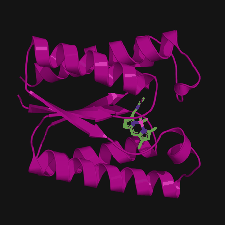

<p align="center">
  
</p>

<p align="center"><em>A flow-matching foundation model for protein design — Baker Lab × NVIDIA GenAI</em></p>

<p align="center">
  
</p>

RFProteína generates proteins — and RNA, DNA, and small-molecule complexes — under rich conditioning.

Check out the **[RFProteína website](https://private-organization.github.io/RFD4-Proteina/)** for complete benchmarks and documentation.

Two ways in:

- 🎯 **Run designs** → [inference quickstart](#inference-quickstart) below, then the full **[Inference guide](docs/INFERENCE.md)**.
- 🛠️ **Train or develop** → the **[Training & Development guide](docs/DEVELOPMENT.md)**.

---

## Setup

These instructions use [`uv`](https://github.com/astral-sh/uv). Prefer apptainer or docker? See
[Running in a container](#running-in-a-container).

You need a Linux machine with an NVIDIA GPU, `git`, and `curl`.

```bash
bash setup.sh                 # installs uv, the atomworks submodule, a py3.12 venv, and deps
source .venv/bin/activate
```

Point RFProteína at a local data directory and create a tiny env file for it:

```bash
export CLUSTER=local
export DATA_PATH="$PWD/data_path"
mkdir -p "$DATA_PATH"
printf 'DATA_PATH=%s\n' "$DATA_PATH" > .ipd/.env.local   # startup reads a per-cluster env file
```

Download the model (two checkpoints, ~4 GB each) over public HTTPS — no credentials:

```bash
./scripts/download_example_data.sh "$DATA_PATH"
```

---

## Running in a container

Prefer apptainer or docker over `uv`? Image definitions ship in the repo (and on configured clusters the
prebuilt SIFs are symlinked in place):

- **Apptainer** — `.ipd/apptainer/` holds the definitions and SIFs (`latent-dev.def` /
  `latent-dev.sif`). Run any command inside the image with a repo bind mount and GPU:
  ```bash
  apptainer exec --nv --bind "$PWD" .ipd/apptainer/latent-dev.sif \
      python src/rfproteina/generate.py inputs=data/benchmarks/monomer.json out_dir=./runs/smoke
  ```
  Where no prebuilt SIF is staged, build one: `apptainer build latent-dev.sif .ipd/apptainer/latent-dev.def`.
- **Docker** — Dockerfiles are in `.ipd/docker/` (e.g. `latent-dev.Dockerfile`).
- **Auto** — the entry scripts re-exec themselves inside the SIF when `CONTAINER_TYPE=apptainer`, so
  running `./src/rfproteina/generate.py …` directly uses the container, while
  `python src/rfproteina/generate.py …` uses your local environment.

You still set `DATA_PATH` and download the model as in [Setup](#setup) — only the Python environment differs.

---

## Inference quickstart

Generate one design to confirm the setup (checkpoints load from `$DATA_PATH`, so no checkpoint args):

```bash
python src/rfproteina/generate.py \
    inputs=data/benchmarks/monomer.json \
    num_replicates=1 out_dir=./runs/smoke
```

A CIF appears under `./runs/smoke/`. From here:

- **[Full inference guide](docs/INFERENCE.md)** — design use cases (binders, enzymes, motif
  scaffolding), conditioning, partial diffusion, reward-guided search, and every parameter.
- **[Annotated CIF inputs](docs/annotated_cif_inputs.md)** — the recommended input format (motifs, hotspots, ligands, bonds, H-bonds, RASA, PTMs, read natively; legacy JSON: [input spec](docs/input.md)).

---

## Training & development

Continue training the released model on your own data, add datasets or design tasks, or work on the
architecture — all in the same `uv` environment. See the
**[Training & Development guide](docs/DEVELOPMENT.md)**, which includes a fresh-cluster,
no-container walkthrough that finetunes the released checkpoint on a tiny example dataset.

---

## Links

- 🌐 **[Benchmarks &amp; gallery](https://private-organization.github.io/RFD4-Proteina/)** — how RFProteína compares (design quality, speed, compute).
- 🎯 **[Inference guide](docs/INFERENCE.md)** · 🛠️ **[Training guide](docs/DEVELOPMENT.md)** · 📄 **[Annotated CIF inputs](docs/annotated_cif_inputs.md)** · 🤝 **[Contributing](CLAUDE.md)**
