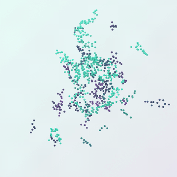

<p align="center">
  
</p>

<p align="center"><em>A flow-matching foundation model for biomolecular design — Baker Lab × NVIDIA GenAIR</em></p>

<p align="center">
  <a href="https://codecov.io/gh/RosettaCommons/RFD4-Proteina/tree/main"></a>
  <a href="pyproject.toml"></a>
  <a href="https://rosettacommons.github.io/RFD4-Proteina/"></a>
  <a href="LICENSE"></a>
</p>

<picture>
  <source media="(max-width: 600px)" srcset="assets/readme/design-gallery-mobile.png">
  
</picture>

RFD4-Proteína designs proteins and biomolecular complexes with sequence–structure co-design,
motif and binding-site conditioning, partial diffusion, and reward-guided search.

## Install

**Start with `make setup`.** On Linux x86_64 with Python 3.12 and a
[supported NVIDIA GPU](https://rosettacommons.github.io/RFD4-Proteina/installation.html#supported-hardware)
with a CUDA 13-compatible driver:

```bash
git clone https://github.com/RosettaCommons/RFD4-Proteina.git
cd RFD4-Proteina
make setup
source .venv/bin/activate
```

Setup installs the environment, downloads the released flow and autoencoder checkpoints
(about 8 GB), and configures `DATA_PATH`. See the
[installation guide](https://rosettacommons.github.io/RFD4-Proteina/installation.html)
for CUDA build prerequisites, optional metrics, and cluster setup.

## Run the model

After setup, generate a design from the included [example input](data/benchmarks/monomer/monomer-short.cif):

```bash
rfd4-generate inputs=data/benchmarks/monomer/monomer-short.cif \
    num_replicates=1 out_dir=./runs/first \
    compile_lengths=null
```

Designs are written to `runs/first/inference_samples/`. Increase `num_replicates`
for more designs, or replace the example path
with your own [annotated input](https://rosettacommons.github.io/RFD4-Proteina/workflow/inputs.html).

- [Running the model](https://rosettacommons.github.io/RFD4-Proteina/workflow/running.html): binders, motif scaffolding, partial diffusion, and sampling settings.
- [Input preparation](https://rosettacommons.github.io/RFD4-Proteina/workflow/inputs.html) · [Text-based design specifications](https://rosettacommons.github.io/RFD4-Proteina/workflow/condition-spec.html)
- [Scoring and refolding](https://rosettacommons.github.io/RFD4-Proteina/workflow/metrics.html) · [Reward-guided search](https://rosettacommons.github.io/RFD4-Proteina/workflow/search.html)
- [Training and fine-tuning](https://rosettacommons.github.io/RFD4-Proteina/development.html) · [Worked examples](https://rosettacommons.github.io/RFD4-Proteina/examples.html)

[Documentation](https://rosettacommons.github.io/RFD4-Proteina/) · [Contributing](https://rosettacommons.github.io/RFD4-Proteina/contributor_guide.html) · [BSD 3-Clause license](LICENSE)

<p align="center">
  
</p>
