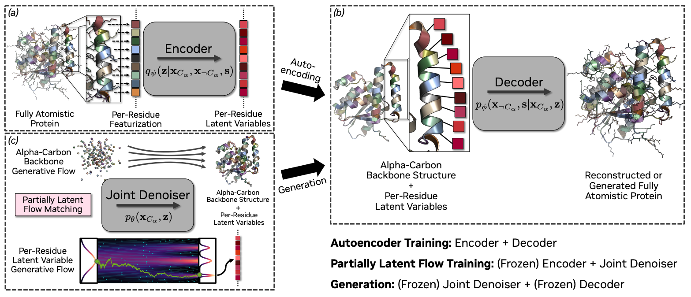
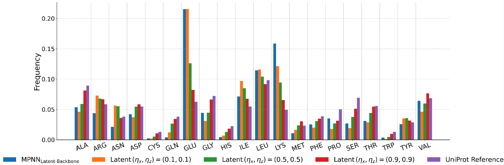

# Protein Foundation Model

A flow-matching based generative model for protein design, supporting proteins, RNA, DNA, and small molecules under complex conditioning constraints.

<p align="center">
  
</p>

> [!NOTE]
> Looking for information about input configuration options? See the full [input specification](docs/input.md).

## Table of Contents

- [Getting Started](#getting-started)
- [Running Inference from the Command Line](#running-inference-from-the-command-line)
- [Parameter Reference](#parameter-reference)
- [Cluster Launching (SLURM)](#cluster-launching-slurm)
- [Design Use Cases](#design-use-cases)
- [Supported Conditioning](#supported-conditioning)
- [Partial Diffusion](#partial-diffusion)
- [Inference Noise Parameters](#inference-noise-parameters)
- [Evaluating Results](#evaluating-results)
  - [Adding Custom Metrics](#adding-custom-metrics)
- [Search and Refinement](#search-and-refinement)
- [Output Files](#output-files)
- [For Developers](#for-developers)
- [Troubleshooting](#troubleshooting)

---

## Getting Started

A `setup.sh` script automates most of the setup below. Run it from the repo root on a new Linux machine:

```bash
bash projects/proteinfoundation/setup.sh
```

It installs `uv`, initialises the atomworks submodule, creates the virtualenv, installs all dependencies, appends `CLUSTER`/`CONTAINER_TYPE` exports to your shell rc file, and auto-creates a `.user_info_<cluster>` SLURM config. The steps below explain each stage if you prefer to run them manually.

### 1. Install uv

[uv](https://github.com/astral-sh/uv) manages the Python environment.

```bash
curl -LsSf https://astral.sh/uv/install.sh | sh
source "$HOME/.local/bin/env"   # add uv to PATH for this session
```

### 2. Initialise the atomworks submodule

The model requires [atomworks](https://github.com/RosettaCommons/atomworks), which lives as a git submodule under `lib/atomworks`. If it was not cloned automatically:

```bash
git submodule update --init lib/atomworks
```

### 3. Create the virtual environment

From the repo root (`foundry-dev/`):

```bash
uv python install 3.12
uv venv --python 3.12
source .venv/bin/activate
```

### 4. Install dependencies

```bash
uv pip install -e ".[rf3,rfd3,all,dev]" \
    -e projects/proteinfoundation \
    -e "lib/atomworks[dev,ml,openbabel,docs]"
```

### 5. Configure your shell

Add the following to `~/.bashrc` or `~/.zshrc`, setting `CLUSTER` to whichever cluster you submit jobs on (`digs`, `ord`, `gb200`, `coreweave`):

```bash
# Cluster identity for proteinfoundation SLURM launch scripts.
# CLUSTER selects which slurm_utils/.user_info_<cluster> config is loaded.
# CONTAINER_TYPE is 'apptainer' (DIGS/CoreWeave) or 'docker' (OCI/ORD/GB200).
export CLUSTER=digs
export CONTAINER_TYPE=apptainer
```

Then reload: `source ~/.bashrc`

### 6. SLURM cluster config

A `.user_info_<cluster>` file (in `slurm_utils/`) holds your SLURM settings (partition, runtime, WandB key, etc.). `setup.sh` creates one automatically from the example template. For most inference workflows no changes are needed; edit it if you need to customise partitions, runtimes, or other SLURM options.

### 7. Checkpoints

Pass checkpoint paths at runtime:

```bash
python proteinfoundation/generate.py \
    ckpt_path=/path/to/checkpoints ckpt_name=model.ckpt ...
```

Set `autoencoder_ckpt_path` in your config or `.env` only if using gradient-ascent refinement.

---

## Running Inference from the Command Line

A `batch_size` of 8 is a reasonable starting point. Larger batches process faster, but first test your longest sequence at `batch_size=1` to confirm it fits in GPU memory before scaling up.

```bash
python proteinfoundation/generate.py \
    inputs=design.json ckpt_path=./checkpoints ckpt_name=model.ckpt \
    num_replicates=100 batch_size=8
```

Inputs can be JSON, YAML, CIF, or PDB files. See the [input specification](docs/input.md) for the full schema.

> **Syntax note**: All arguments use `key=value` (Hydra style), not `--key value`.

For easy cluster submission via SLURM launch scripts, see [Cluster Launching (SLURM)](#cluster-launching-slurm) below.

---

## Parameter Reference

| Parameter | Description | Default |
| --- | --- | --- |
| `inputs` | Input file (JSON/YAML/CIF/PDB) or directory | Required |
| `ckpt_path` | Directory containing checkpoint | Required |
| `ckpt_name` | Checkpoint filename | Required |
| `num_replicates` | Designs generated per input example | 1 |
| `batch_size` | Designs processed in parallel on GPU | 1 |
| `seed` | Random seed (`null` = different seed each run) | null |
| `skip_existing` | Skip examples whose output files already exist on disk | false |
| `subset_to_examples` | Run only specific examples from a JSON, as comma-separated keys | null |
| `global_prefix` | String prefix prepended to all output file paths | null |
| `out_dir` | Output directory (auto-inferred from checkpoint path if not set) | null |
| `inference_experiment` | Config group controlling generation parameters (nsteps, noise, metrics) | `inference` |
| `generation.args.nsteps` | Diffusion steps — higher is slower but often better quality | 400 |
| `generation.args.guidance_w` | Guidance weight (1.0 = unconditional; increase for stronger conditioning) | 1.0 |
| `generation.args.self_cond` | Self-conditioning — leave enabled for best quality | true |
| `generation.model.bb_ca.simulation_step_params.sc_scale_noise` | Backbone stochasticity temperature — see [Inference Noise Parameters](#inference-noise-parameters) | 0.1 |
| `generation.model.local_latents.simulation_step_params.sc_scale_noise` | Sidechain/sequence stochasticity temperature — see [Inference Noise Parameters](#inference-noise-parameters) | 0.1 |
| `metrics_tags` | Tags that activate specific evaluation metrics; comma-separated string or list — see [Evaluating Results](#evaluating-results) | `[]` |

**RFD3 aliases**: `diffusion_batch_size` → `batch_size`, `json_keys_subset` → `subset_to_examples`.

> [!WARNING]
> **RFD3 users — no ORI token.** This model does not use an ORI residue in the input structure. The model has been trained to select a reasonable COM, and its position relative to other chains can be guided using hotspots (proteins) or RASA (ligands).

---

## Cluster Launching (SLURM)

The `slurm_utils/` scripts handle submitting `generate.py` as SLURM jobs. All standard command-line options can be passed as usual. After generation, a dependent SLURM job automatically concatenates per-job CSV metrics into a single file.

Default SLURM settings (partition, runtime, etc.) are read from `slurm_utils/.user_info_<cluster>`, which `setup.sh` creates automatically. Any setting can be overridden per-invocation with CLI flags — if not specified, the `.user_info_<cluster>` default is used.

### SLURM option overrides

| Flag | Description | DIGS default |
| --- | --- | --- |
| `--njobs N` | Parallel generation jobs (split input across N array tasks) | 1 |
| `--gpus-per-job N` | GPUs per array task | 1 |
| `--partition <name>` | SLURM partition | `gpu` |
| `--time <HH:MM:SS>` | Wall-clock time limit | `12:00:00` |
| `--gres <spec>` | SLURM `--gres` (e.g. `gpu:a4000:1`); overrides `--gpus-per-job` | — |
| `--mem <size>` | Memory per node (e.g. `64g`); omitted by default, letting SLURM use its cluster default | — |
| `--copy` | Copy the repo to the run directory before submitting | — |
| `--no-concatenate` | Skip the automatic post-generation metrics merge job | — |
| `--no-foldseek` | Disable structural diversity clustering during concatenation | — |
| `--follow` / `-f` | Tail logs after submission | — |

### Inference

```bash
# 4 replicates over a subset of an input file, split across 2 jobs
./slurm_utils/launch_infer.sh digs --njobs 2 \
    inference_experiment=inference_like_rfd3 \
    inputs=/path/to/benchmarks/monomer.json subset_to_examples=monomer-short \
    ckpt_path=/path/to/checkpoints ckpt_name=last.ckpt \
    out_dir=/path/to/outputs run_name_=my_run num_replicates=4 batch_size=8
```

Generation parameters (nsteps, noise scales, etc.) live in the `inference_experiment` config. Rather than passing them on the command line, create a new config in `configs/inference_experiment/` that inherits from `inference_like_rfd3` and defines your overrides.

### Parameter Sweeps

Run the same pipeline across many parameter combinations, with one SLURM job per combination:

```bash
# Sweep nsteps × noise scale on a val set (Foldseek clustering on by default)
./slurm_utils/launch_sweep.sh digs \
    --sweep-config configs/sweeps/sweep_example.yaml \
    --base-out-dir /path/to/out_dir --njobs 2 \
    ckpt_path=/path/to/checkpoints ckpt_name=last.ckpt

# Preview configs without submitting
./slurm_utils/launch_sweep.sh digs \
    --sweep-config configs/sweeps/sweep_example.yaml --dry-run
```

See `configs/sweeps/` for pre-built sweep configs and the [Search and Refinement guide](docs/search_and_refinement.md#inference-sweeps) for the sweep config format.

### Search (Beam / Best-of-N)

Search strategies are selected via `inference_experiment` configs:

```bash
# Beam search with RF3 reward (parameters set in the experiment config)
./slurm_utils/launch_infer.sh digs --njobs 2 \
    inference_experiment=inference_beam_example \
    ckpt_path=/path/to/checkpoints ckpt_name=last.ckpt \
    out_dir=/path/to/outputs
```

---

## Design Use Cases

The model supports a wide range of biomolecular design tasks. Each link below provides example inputs and run commands.

<table>
  <tr>
    <td align="center">
      <h3><a href="docs/protein_binder_design.md">Protein binder design</a></h3>
      Design proteins that bind a target protein at specified hotspot residues.
      <br><em>⚠️ Not fully supported in the current checkpoint — planned.</em>
    </td>
    <td align="center">
      <h3><a href="docs/small_molecule_binder_design.md">Small molecule binder design</a></h3>
      Design proteins that bind small molecule ligands with burial/exposure control.
    </td>
    <td align="center">
      <h3><a href="docs/dna_binder_design.md">DNA binder design</a></h3>
      Design transcription-factor-like proteins that bind DNA.
      <br><em>⚠️ Not fully supported in the current checkpoint — planned.</em>
    </td>
  </tr>
  <tr>
    <td align="center">
      <h3><a href="docs/enzyme_design.md">Enzyme design</a></h3>
      Design enzymes with catalytic residues around a ligand active site.
    </td>
    <td align="center">
      <h3><a href="docs/motif_scaffolding.md">Motif scaffolding</a></h3>
      Build a complete protein around one or more structural motifs.
    </td>
    <td align="center">
      <h3><a href="docs/unconditional_generation.md">Unconditional generation</a></h3>
      Generate novel protein structures from scratch.
    </td>
  </tr>
</table>

---

## Supported Conditioning

The table below lists all conditioning modalities and their current status. Each is specified per-residue or per-atom in the input spec — see [Input Specification](docs/input.md) for syntax.

| Conditioning | Input field | Status |
| --- | --- | --- |
| **Coordinate (indexed motif)** | `contig` + `select_fixed_atoms` | ✅ Supported |
| **Coordinate (unindexed motif)** | `unindex` | ✅ Supported |
| **Sequence constraint** | `select_unfixed_sequence` | ✅ Supported |
| **Hotspot residues** | `select_hotspots` | ✅ Supported |
| **Partial diffusion** | `partial_t` / `partial_t_backbone` / `partial_t_latent` | ✅ Supported |
| **Small molecules / ligands** | `ligand` | ✅ Supported |
| **Internal coordinate** | `contig` + relative geometry | 🔜 Planned |
| **Symmetry** | `symmetry` | 🔜 Planned |
| **H-bond donors/acceptors** | `select_hbond_donor` / `select_hbond_acceptor` | 🔜 Planned |
| **RASA (buried/exposed)** | `select_buried` / `select_exposed` | 🔜 Planned |
| **Secondary structure** | `select_helix_conditioning` / `select_sheet_conditioning` | 🔜 Planned |
| **CATH fold class** | `add_cath_code` | 🔜 Planned |

> **Planned features** are parsed and stored in the input spec but the model is not yet trained to respond to them. Passing them will not cause errors but will have no effect on generation.

---

## Partial Diffusion

Partial diffusion starts the denoising from a noisy (but non-random) initial state, allowing you to refine an existing structure without re-generating it from scratch.

Enable it by setting `partial_t_backbone` and/or `partial_t_latent` in the input spec. The value is a corruption level, **not** a noise level in Angstroms: 1 = input structure unchanged, 0 = fully random noise.

```yaml
# design.yaml
input: my_structure.pdb
contig: A1-100
partial_t_backbone: 0.8   # 1 = no change, 0 = fully random
```

**Backbone, sequence/rotamer, and step count are completely decoupled.**

| Input spec field | Controls | Default if omitted |
| --- | --- | --- |
| `partial_t_backbone` | Backbone Cα noise only | `0.0` (fully diffused) |
| `partial_t_latent` | Sidechain/sequence latent noise only | `0.0` (fully diffused) |

The number of denoising steps (`nsteps`) is independent of noise level. Setting `partial_t=0.5` does not halve the number of steps — the sampler schedules exactly `nsteps` denoising steps over the range `[partial_t, 1.0]`.

> **Note**: `partial_t` values must be set in the input spec, not on the command line. Different examples in the same JSON can use different noise levels.

---

## Inference Noise Parameters

The model uses **product-space flow matching** with two separate flows: backbone Cα coordinates and sidechain latent variables. The stochasticity temperatures control generation diversity:

| Parameter | Config Key | Controls | Default |
| --- | --- | --- | --- |
| **Backbone temperature** (η_x) | `generation.model.bb_ca.simulation_step_params.sc_scale_noise` | Structural diversity | 0.1 |
| **Latent temperature** (η_z) | `generation.model.local_latents.simulation_step_params.sc_scale_noise` | Sidechain/sequence diversity | 0.1 |

Higher values increase diversity but may reduce designability; lower values produce more deterministic, higher-confidence outputs.

<p align="center">
  
</p>

- **(0.1, 0.1)**: Low noise — sequences close to MPNN baseline, high designability.
- **(0.5, 0.5)**: Moderate noise — sequences shift toward the natural UniProt distribution.
- **(0.9, 0.9)**: High noise — sequences most closely match natural amino acid frequencies, maximum diversity.

```bash
# Moderate noise for more natural-like sequences
python proteinfoundation/generate.py \
    inputs=design.json ckpt_path=./checkpoints ckpt_name=model.ckpt \
    generation.model.bb_ca.simulation_step_params.sc_scale_noise=0.5 \
    generation.model.local_latents.simulation_step_params.sc_scale_noise=0.5
```

For the full inference configuration and training-time flow matching parameters, see the [Developer Guide](docs/DEVELOPMENT.md#flow-matching-parameters).

---

## Evaluating Results

### Running Metrics Inline

Pass `metrics_tags` during inference to compute metrics immediately after each design. Results are written to `per_example_metrics.csv` alongside the CIF files. Multiple tags can be passed as a comma-separated string.

```bash
# Single tag
python proteinfoundation/generate.py \
    inputs=design.json ckpt_path=./checkpoints ckpt_name=model.ckpt \
    num_replicates=50 metrics_tags=unconditional_refolding

# Multiple tags
python proteinfoundation/generate.py \
    inputs=design.json ckpt_path=./checkpoints ckpt_name=model.ckpt \
    num_replicates=50 metrics_tags=ppi_refolding,hotspot_conditioning
```

| Tag | Activates |
| --- | --- |
| `unconditional_refolding` | RF3 refolding + pLDDT/scRMSD for unconditional generation |
| `ppi_refolding` | RF3 refolding + target templating + interface metrics for protein binder design |
| `motif_scaffold_refolding` | RF3 refolding + motif RMSD for motif scaffolding / enzyme design |
| `sm_binder_refolding` | RF3 refolding + binding metrics for small molecule binder design |
| `ame_refolding` | RF3 refolding for enzyme (MCSA) active-site benchmarks |
| `hotspot_conditioning` | Hotspot obedience metrics (requires hotspot input) |
| `3d_coordinate_conditioning` | Motif coordinate RMSD metrics |
| `hbond_conditioning` | H-bond satisfaction metrics |
| `rasa_conditioning` | RASA adherence metrics |

Metrics that require a tag will be silently skipped if the tag is not present.

### Concatenating Multi-Job Runs

When running large evaluations in parallel across multiple SLURM jobs, each job writes its own `per_example_metrics_job{N}.csv`. After all jobs complete, concatenate them:

```bash
python -m proteinfoundation.inference_utils.concatenate_external_eval_results \
    --output_dir ./inference/my_run/metrics/
```

This script finds all `per_example_metrics_job*.csv` files, concatenates them, aggregates per-task mean metrics into `aggregated_metrics.csv`, and moves individual job files into `job_results/`. When using `launch_infer.sh`, this runs automatically as a dependent SLURM job.

Pass `--cluster_with_foldseek` to also run structural diversity clustering (see below).

### Adding Custom Metrics

You can add your own evaluation metrics without modifying any tracked files. You can add custom metrics by creating these files, which are automatically git-ignored:

- `proteinfoundation/metrics/custom_metrics.py` — Python metric classes
- `configs/metrics/custom_metrics.yaml` — Hydra config registering those classes

**Quick example** — count residues in each design:

```python
# proteinfoundation/metrics/custom_metrics.py
from biotite.structure import AtomArray
from foundry.metrics.metric import Metric

class ResidueCountMetric(Metric):
    def __init__(self, min_length: int | None = None, **kwargs):
        super().__init__(**kwargs)          # passes tag-filter args from YAML
        self.min_length = min_length

    @property
    def kwargs_to_compute_args(self) -> dict:
        return {"atom_array": ("predicted_atom_array",)}

    def compute(self, atom_array: AtomArray) -> dict[str, float]:
        n_residues = len(set(zip(atom_array.chain_id, atom_array.res_id)))
        result = {"n_residues": float(n_residues)}
        if self.min_length is not None:
            result["meets_min_length"] = float(n_residues >= self.min_length)
        return result
```

```yaml
# configs/metrics/custom_metrics.yaml
residue_count:
  _target_: proteinfoundation.metrics.custom_metrics.ResidueCountMetric
  min_length: 50                                # constructor argument
  required_tags_any: ["unconditional_refolding"] # omit to always run
```

Results appear in `per_example_metrics.csv` as `residue_count.n_residues`, `residue_count.meets_min_length`.

For a full explanation of `kwargs_to_compute_args`, how to write metrics that operate on RF3-refolded structures (nested inside `RF3Metric`), and how to contribute a metric back, see **[docs/custom_metrics.md](docs/custom_metrics.md)**.

> **Broadly useful?** If your metric isn't specific to your design problem, consider contributing it. Both files are git-ignored so your local experiments stay private, but the full contribution workflow (branch → tracked file → PR) is described in the doc above.

### FoldSeek Diversity Clustering

When `--cluster_with_foldseek` is passed, structures are clustered by structural similarity using [FoldSeek](https://github.com/steineggerlab/foldseek), adding a `foldseek_cluster_id` column for counting structurally distinct designs per task.

**Clustering is scoped to the designed chain.** In multimer outputs (e.g. binder + target), only the most freely designed chain is extracted and clustered. This chain is identified automatically from the conditioning annotations and stored as `chain_of_interest` in the metrics CSV.

FoldSeek must be installed and available on `$PATH` (set `FOLDSEEK_EXEC` in `.env`). For monomers, clustering uses TM-score (threshold 0.5); for multimers, it additionally uses interface lDDT.

---

## Search and Refinement

Beyond standard sampling, the model supports search strategies to explore multiple generation paths and refinement strategies to optimize structures post-generation. Full details in the [Search and Refinement guide](docs/search_and_refinement.md).

### Search Strategies

| Strategy | Description | Use Case |
| --- | --- | --- |
| **Vanilla** | Standard diffusion sampling | Baseline, fastest |
| **Best-of-N** | Generate N samples, pick highest reward | Simple, effective, parallelizable |
| **Beam Search** | Maintain top-k candidates, prune at checkpoints | Best quality, slower |

```bash
# Best-of-N with RF3 reward
python proteinfoundation/generate.py \
    --config-name inference_test_search \
    inputs=design.json \
    ckpt_path=./checkpoints ckpt_name=model.ckpt \
    search.strategy=best_of_n search.strategy.n_samples=50 \
    reward=rf3
```

### Refinement Strategies

> [!WARNING]
> Refinement strategies are not fully supported in the current checkpoint.

| Strategy | What it optimizes | Requires Autoencoder | Speed |
| --- | --- | --- | --- |
| **BindCraft** | Sequence only (structure fixed) | No | Fast |
| **Gradient Ascent** | Latents (structure + sequence) | Yes | Medium |

```bash
# BindCraft: optimize sequence with AF2 reward
python proteinfoundation/refine.py \
    --config-name refine_bindcraft \
    inputs=my_binder.pdb

# Gradient ascent: optimize in latent space
python proteinfoundation/refine.py \
    --config-name refine_gradient_ascent \
    inputs=my_binder.pdb \
    autoencoder_ckpt_path=/path/to/autoencoder.ckpt
```

### Available Reward Models

Reward models score generated structures to guide search and refinement. Configure via YAML files in `configs/rewards/`.

| Config | Category | Key Signals | Differentiable |
| --- | --- | --- | --- |
| `rf3.yaml` | Refolding | pLDDT, ipTM, ipAE, min_ipAE | Yes |
| `af2_binder.yaml` | Refolding | pLDDT, pTM, PAE, max_PAE | Yes |
| `multi_source.yaml` | Refolding + Force Field + Quality | ipAE, H-bonds, RASA, clashes | No |
| `structure_quality.yaml` | Structure Quality | Sidechains, SSE, RASA, MolProbity | No |

See the [Search and Refinement guide](docs/search_and_refinement.md) for the full metric catalog and custom reward creation.

---

## Output Files

Each generated design is saved as a CIF file with custom per-atom annotations recording how each residue was produced.

### CIF Annotations

| Annotation | Level | Description |
| --- | --- | --- |
| `src_component` | Residue | Source component identifier. Tracks which part of the input spec a residue originated from. |
| `mapped_to_coordinate_conditioned_region` | Atom | `True` for atoms whose final coordinates were mapped from a coordinate-conditioned motif region. |
| `mapped_to_coordinate_conditioned_region_token_lvl` | Residue | Residue-level aggregation of the above. Use this to identify regions to hold fixed in downstream sequence redesign (e.g. ProteinMPNN). |
| `coords_with_insertion` | Atom | Coordinates after inserting motif atoms into the generated backbone. |
| `src_coordinate_conditioned_region` | Atom | Identifies which input motif region provided coordinate conditioning for each atom. |

---

## For Developers

Training, SLURM launching, dataset configuration, design task implementation, adding new metrics/rewards, and architecture details are documented in the **[Developer Guide](docs/DEVELOPMENT.md)**.

For coding standards and contribution guidelines, see [CLAUDE.md](CLAUDE.md).

---

## Troubleshooting

| Issue | Solution |
| --- | --- |
| `Import errors` / `hydra not found` in launch scripts | Activate the venv: `source .venv/bin/activate` (works from repo root or `projects/proteinfoundation/`) |
| `Hydra config errors` | Use `=` not `--` for arguments: `inputs=file.cif` not `--inputs file.cif` |
| `Out of memory` | Reduce `batch_size`; test your longest sequence at `batch_size=1` first |
| `atomworks not found` | Run `git submodule update --init lib/atomworks` |
| `DATA_PATH not set` | Ensure `.ipd/.env.<cluster>` is committed and your cluster's `.user_info_<cluster>` sources it |
| `Autoencoder checkpoint not found` | Update `autoencoder_ckpt_path` in config |

See the [Developer Guide troubleshooting section](docs/DEVELOPMENT.md#troubleshooting) for the full list.
