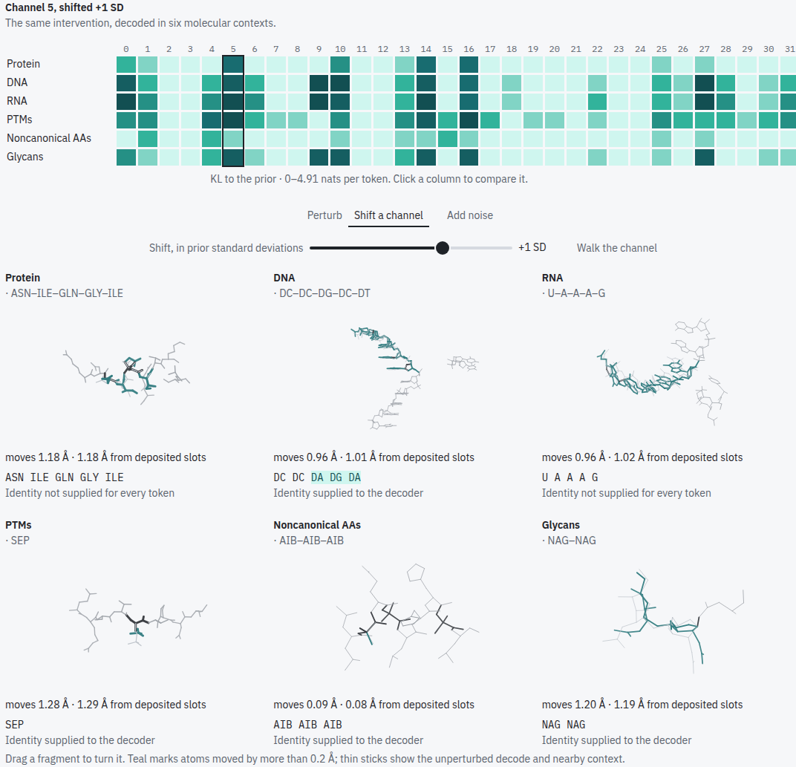
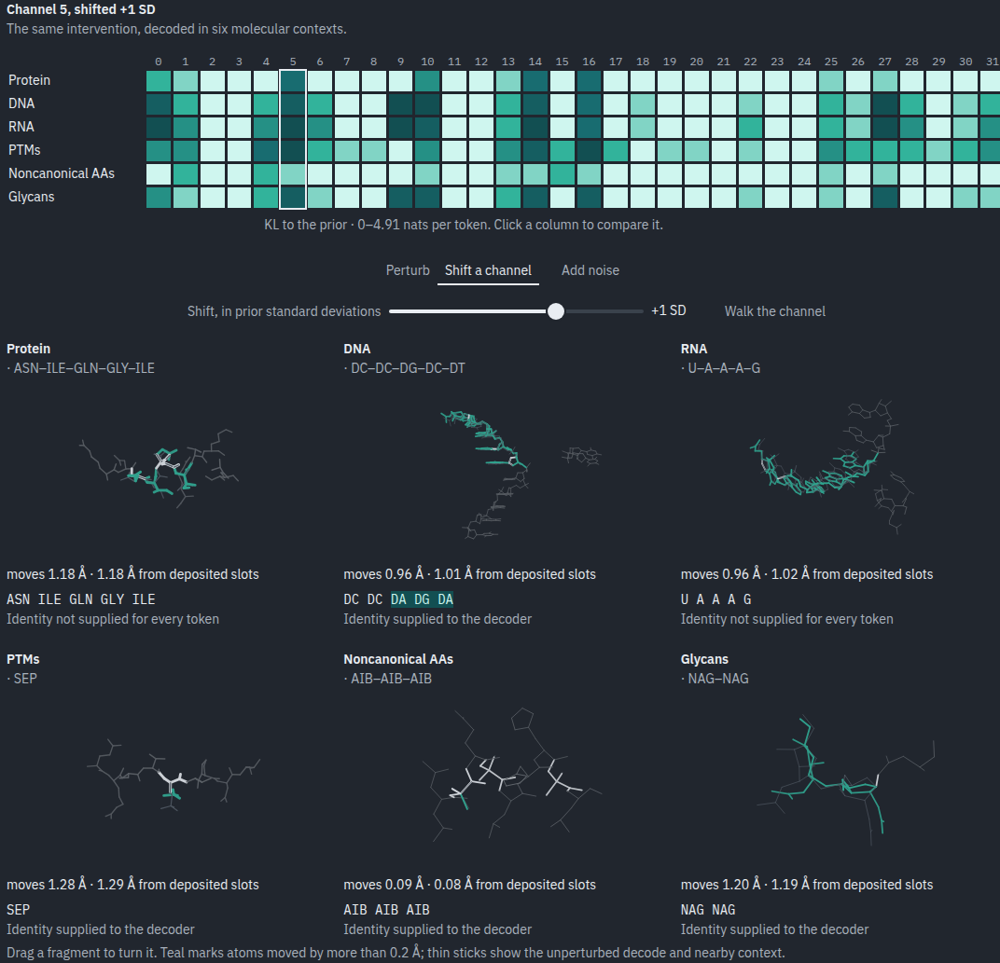

# Thirty-two numbers, six molecular contexts

```{raw} html
<p class="viz-dek">Move one latent channel. Watch a protein, DNA, RNA, a phosphorylated residue, a noncanonical amino acid and a glycan respond together.</p>
<p>Pick a column, shift it, walk along it, or add noise. All six views show actual decodes from the release autoencoder, with anchors and native identity conditions fixed.</p>
<div class="viz-stage viz-stage-wide arch-band" data-viz-page="expanded" aria-label="Six simultaneous molecular views: protein, DNA, RNA, phosphorylation, noncanonical amino acids and glycans">


</div>
<script type="module" src="../_static/viz/js/latents-expanded.js"></script>
<p class="viz-caption">Top: protein, DNA, RNA. Bottom: phosphorylation (phosphoserine, SEP), noncanonical amino acids (AIB), glycans. Up to five nearby tokens per view; the full input remains decoder context. Sticks follow deposited atom slots, not validated new chemical topology.</p>
```

## Where do the nats go?

Half the protein KL rate sits in just **three of 32 channels**. The phosphorylation
subset needs **eight**. Switch to decoder sensitivity to see whether a high-rate
channel also moves atoms when removed. **Noise tolerance** shows how reconstruction
changes under three actual noise draws on all 32 channels.

```{raw} html
<div id="expanded-rate-plots" class="viz-figure expanded-information" aria-label="Measured rate concentration and channel-ablation plots"></div>
```

A **nat** is a log-probability unit. Here the rate is KL from the posterior to the
unit-normal prior; it includes prior mismatch and is **not mutual information**.
“Active” means the posterior mean varies across tokens: `Var(μ) > 0.01`.
Rate, activity and decoder sensitivity answer different questions.
[Fixing a Broken ELBO](https://proceedings.mlr.press/v80/alemi18a.html) motivates
reading compression together with reconstruction. Our noise sweep holds the
checkpoint fixed; it is not an optimized rate–distortion frontier.

## Identity is also an input

Removing supplied identity changes recovery from **100% to 0%** in both small
phosphorylation and AIB/norleucine subsets. Glycans fall to **68.6%**. The latent is
only one input to the decoder; native identity recovery alone cannot establish
what it encodes.

The glycan average hides a large imbalance: **160 of 229 tokens are NAG**.
Always choosing NAG would score **69.9%**; averaging the cleared-identity
accuracy equally across the eight identities gives **14.0%**. DNA and RNA both retain
**99.8%** under that same equal-identity average.
This probes dependence on supplied identity, not whether the latent contains
no identity information or whether sequence is generated before structure.
[Per-identity counts and the reproducible audit](../_static/viz/expanded-data/feature-audit.json.gz).

```{raw} html
<figure class="viz-figure expanded-information"><div id="expanded-identity-plot"></div><figcaption class="viz-caption">Identity recovery: filled dots use native conditions; open dots clear supplied identity. Overlapping dots mean no change. Protein and RNA already receive no identity. Clearing a trained condition is an off-distribution diagnostic.</figcaption></figure>
```

The PTM statistics cover **38 SEP/TPO tokens**; noncanonical statistics cover
**39 AIB/NLE tokens**. These are explicit subsets of the measured cohort, not a
complete classification of modified amino acids. The views use one representative
input each, selected by identity and input order, never by reconstruction quality.

```{raw} html
<details class="arch-methods"><summary>Picked channel: exact rates, activity and ablation</summary>
<p>Channel <strong data-expanded-channel>5</strong>. Rates and activity use each panel's measured subset; ablation measures movement in its representative input.</p>
<table><thead><tr><th>Context</th><th>KL nats/token</th><th>Variance of μ</th><th>Active</th><th>Ablation, Å</th></tr></thead><tbody id="expanded-channel-stats"></tbody></table>
</details>
<details class="arch-methods"><summary>Checkpoint, measurements and limitations</summary>
```

The latent has 32 channels per emitted residue. Both encoder and decoder have 12
transformer layers of width 768 with 12 attention heads, query/key normalization,
and no attention pair bias, pair updates, or triangle multiplication. The encoder
reads atom coordinates, element/charge and incident-bond features. The decoder
reads the latent, anchor coordinates, token type, and supplied sequence conditions.

The 147-entry vocabulary contains 100 modified/noncanonical amino acids and 13
glycans, alongside standard amino acids and nucleotides and special entries.
Atomized components retain explicit identities; they are excluded from this
residue-latent analysis. Vocabulary size is not evidence that every entry is
well reconstructed or independently generatable.

We sampled 128 inputs from each of five committed temporal-holdout panels with
seed 20261011, using the validation pipeline. All 640 completed.
Examples can contain several chemistries. Counts below include only resolved,
AE-emitted tokens, so neither padded slots nor atomized context contributes.

| Chemistry | Tokens | Observed identities | KL nats/token | Active channels / 32 |
| --- | ---: | ---: | ---: | ---: |
| Standard amino acids | 154,844 | 20 | 18.76 | 21 |
| Modified/noncanonical amino acids | 198 | 25 | 40.75 | 32 |
| Glycans | 229 | 8 | 33.93 | 17 |
| DNA | 6,108 | 4 | 47.05 | 23 |
| RNA | 4,541 | 4 | 50.23 | 24 |

For diagonal posterior `q = Normal(mu, exp(log_scale))`, each channel's KL to the
unit-normal prior is `0.5 * (mu² + exp(2*log_scale) - 1 - 2*log_scale)`. Rates in
the table weight tokens equally. They include prior mismatch and are **not mutual
information estimates**. Different atom counts, chemistry distributions, and
poses can contribute to rate differences.

An active unit has population variance of its posterior mean greater than 0.01.
This definition follows the diagnostic used by
[Burda et al.](https://arxiv.org/abs/1509.00519), rather than interpreting every
nonzero KL as information used by the decoder. Activity is coordinate-dependent
and threshold-sensitive: at 0.1 the respective counts are 13, 29, 16, 18, and 18.
The JSON also provides the 0.001 threshold and example-weighted rates with
example-bootstrap intervals. Overlapping PDB-derived inputs are not independent
structures; these intervals are exploratory, not a held-out performance claim.

The six-context plots partition out phosphorylation (SEP/TPO/PTR; PTR is absent
in this cohort) and AIB/NLE from the original pooled modified-AA group above.
Other modifications remain in that pooled summary but are not assigned to these
two illustrative subsets.

Shifts span −3 to +3 prior standard deviations in steps of 0.5. Noise uses four
scales and three seeded draws, with a fixed direction across scales. Each state
is independently decoded; no coordinate interpolation is presented as inference.
Display offsets are quantized to 0.01 Å. Native conditions and anchors are fixed.
Ablation zeros one channel across all matching tokens in one representative input;
its atom-slot displacement is not a chemical-validity or population-wide score.
The downloadable summary also retains the joint PCA (23.6% variance explained),
which is confounded by pose and chemistry imbalance.

The measurements use the release autoencoder `rfd4-proteina-ae-release-2026-10-19` (global step
400,000, strict load of the EMA weights), the model source at `f5db9617fa98f377cae5984a98187489ea3997a4`
and AtomWorks 3.0.4.

```{raw} html
</details>

```

Latent decoding here keeps the input's anchors and conditions; it is not de novo
sampling from the joint flow prior.

[Architecture explorer](index.rst)

Activity follows [Burda et al.](https://arxiv.org/abs/1509.00519).
For interpreting unused latents, see
[posterior-collapse diagnostics](https://arxiv.org/abs/1901.05534).
