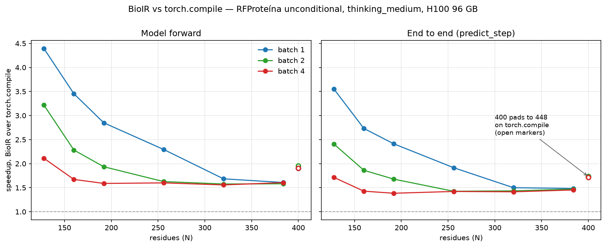
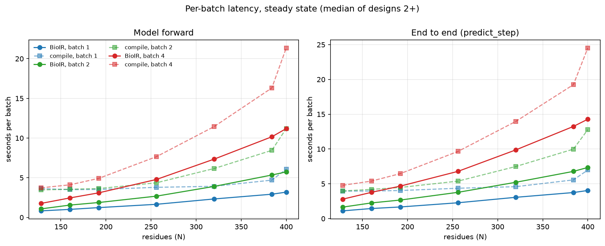

# Full-workflow BioIR versus Torch compile, forward and end to end

Unconditional generation with the released final checkpoints on one NVIDIA
H100 (96 GB, driver 615.71.09), native `thinking_medium`: 60 diffusion steps and
185 trunk passes. This part is not the 80 GB SXM H100 -- it measures about
2.2 TB/s of copy bandwidth rather than the 3.35 TB/s of HBM3 spec, so
memory-bound kernels read slower here than on an H100-80GB-HBM3. Both backends
used the same inputs, seed 11, no oracle scoring, and `CUTEDSL_FORCE_CUBIN=1`.
Each cell ran a discarded cache-warming process, then a measured process of
three batches; every figure below is the median of batches 2+.

Seven lengths x three batch sizes, 21 shapes, all measured in one session.

## Per batch

One `predict_step` over all its rows. Divide by the batch size for per-design
cost.

| N | Batch | BioIR forward | BioIR e2e | Compile forward | Compile e2e | Forward | e2e |
| ---: | ---: | ---: | ---: | ---: | ---: | ---: | ---: |
| 128 | 1 | 0.826 | 1.113 | 3.628 | 3.952 | 4.39x | 3.55x |
| 160 | 1 | 1.013 | 1.450 | 3.499 | 3.962 | 3.45x | 2.73x |
| 192 | 1 | 1.237 | 1.674 | 3.524 | 4.038 | 2.85x | 2.41x |
| 256 | 1 | 1.653 | 2.278 | 3.793 | 4.364 | 2.29x | 1.92x |
| 320 | 1 | 2.327 | 3.060 | 3.920 | 4.589 | 1.68x | 1.50x |
| 384 | 1 | 2.924 | 3.747 | 4.701 | 5.562 | 1.61x | 1.48x |
| 400* | 1 | 3.187 | 4.042 | 6.074 | 6.989 | 1.91x | 1.73x |
| 128 | 2 | 1.077 | 1.650 | 3.464 | 3.972 | 3.22x | 2.41x |
| 160 | 2 | 1.555 | 2.256 | 3.551 | 4.202 | 2.28x | 1.86x |
| 192 | 2 | 1.878 | 2.668 | 3.635 | 4.477 | 1.94x | 1.68x |
| 256 | 2 | 2.682 | 3.779 | 4.364 | 5.388 | 1.63x | 1.43x |
| 320 | 2 | 3.908 | 5.219 | 6.162 | 7.484 | 1.58x | 1.43x |
| 384 | 2 | 5.342 | 6.787 | 8.451 | 9.982 | 1.58x | 1.47x |
| 400* | 2 | 5.737 | 7.352 | 11.205 | 12.788 | 1.95x | 1.74x |
| 128 | 4 | 1.766 | 2.793 | 3.728 | 4.787 | 2.11x | 1.71x |
| 160 | 4 | 2.457 | 3.777 | 4.109 | 5.393 | 1.67x | 1.43x |
| 192 | 4 | 3.098 | 4.671 | 4.922 | 6.468 | 1.59x | 1.38x |
| 256 | 4 | 4.784 | 6.793 | 7.655 | 9.659 | 1.60x | 1.42x |
| 320 | 4 | 7.345 | 9.869 | 11.445 | 13.962 | 1.56x | 1.41x |
| 384 | 4 | 10.160 | 13.246 | 16.311 | 19.249 | 1.61x | 1.45x |
| 400* | 4 | 11.191 | 14.285 | 21.357 | 24.532 | 1.91x | 1.72x |

Over all 21 shapes the median is 1.91x on forward and
1.68x end to end, across ranges of 1.56-4.39x
and 1.38-3.55x. Over the 18 on-bucket shapes alone --
excluding the three marked `*` -- the medians are 1.68x and
1.49x.

## Per design, end to end

| N | BioIR bs1 | Compile bs1 | BioIR bs2 | Compile bs2 | BioIR bs4 | Compile bs4 |
| ---: | ---: | ---: | ---: | ---: | ---: | ---: |
| 128 | 1.113 | 3.952 | 0.825 | 1.986 | 0.698 | 1.197 |
| 160 | 1.450 | 3.962 | 1.128 | 2.101 | 0.944 | 1.348 |
| 192 | 1.674 | 4.038 | 1.334 | 2.239 | 1.168 | 1.617 |
| 256 | 2.278 | 4.364 | 1.889 | 2.694 | 1.698 | 2.415 |
| 320 | 3.060 | 4.589 | 2.610 | 3.742 | 2.467 | 3.490 |
| 384 | 3.747 | 5.562 | 3.393 | 4.991 | 3.312 | 4.812 |
| 400* | 4.042 | 6.989 | 3.676 | 6.394 | 3.571 | 6.133 |

## `*` 400 residues is the one off-bucket length

`compile_lengths` pads 400 up to 448 while BioIR runs it natively, so those
three rows carry padding waste on top of kernel speed. The signature is visible
at every batch: the ratio falls smoothly to about 1.58x at 384 and then jumps
back to about 1.91x at 400, because the compiled arm's forward leaps across the
bucket boundary -- 4.701 to 6.074 s at batch 1, 8.451 to 11.205 s at batch 2,
16.311 to 21.357 s at batch 4. Exclude 400 from a trend line or plot it as its
own series; the other six lengths sit exactly on buckets and compare cleanly.

## Why the lead falls with length and with batch

At 128 residues the compiled arm is launch-bound rather than compute-bound: its
forward barely moves from 128 to 384 residues (3.628 to 4.701 s at batch 1)
while BioIR's tracks the work (0.826 to 2.924 s). That is the regime CUDA graphs
address, and it is where the 4.39x comes from. By 384 residues there is enough
arithmetic that both backends scale with N and the gap settles near 1.6x.

Raising the batch does for the compiled arm what graphs do for BioIR, which is
why batch 4 is flat at 1.56-1.61x across every on-bucket length while batch 1
spans 4.39x down to 1.61x.

## Forward against end to end

`e2e` is `Proteina.predict_step`, the seam both backends cross -- BioIR reaches
it through `predict_full_bioir` -- carrying featurisation, the model, and
formatting into atom arrays. `forward` is the model call inside it, scoped to
match: BioIR runs trunk, sampler and decoder in one call, while the native path
integrates the flow and decodes separately, so `full_simulation` and
`sample_formatting` are accumulated. Only that scoping makes one divisible by
the other; timing `full_simulation` alone omits the native decode and overstates
BioIR.

The difference between the columns is 0.29-3.09 s and grows with length and
batch. It is featurisation and formatting, which both backends pay and neither
backend's kernels touch, so it dilutes every ratio. Quote the forward column for
kernel claims and the e2e column for request-latency claims, and do not mix them
in one figure.

## Limits

Design 1 of each cell is excluded from the medians and reported separately by
the driver. It carries first-touch in the model plus that shape's graph capture
or compilation: 1.09-1.91x of steady for BioIR and 1.45-3.59x for compile. No
runtime warmup removes it, because it depends on the shape.

The driver warms the CUDA context and the BLAS/DNN handles before the timed
region, which is worth 0.42 s of the trunk's first graph warmup on this part and
is paid once per process rather than once per shape. Steady figures are
unaffected by it either way.

Three batches per cell is a thin variance estimate. One process per length and
batch: generation collates across inputs, so pooling lengths into one process
pads a small shape up to a large one at batch > 1 and silently reports a design
at a length it never ran. The driver is
[`benchmark_backends.py`](../../src/script_utils/benchmark_backends.py).
