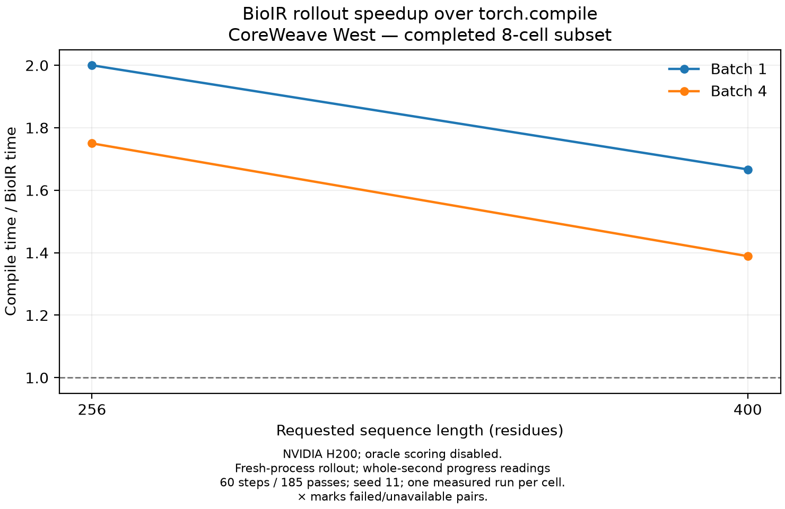

# Full-workflow BioIR versus Torch compile

Unconditional generation with the released final checkpoints on one H200 (CoreWeave West), using the native `thinking_medium` schedule: 60 diffusion steps and 185 trunk passes. Both backends used the same inputs, seed 11, and no oracle scoring. Each cell had a discarded cache-warming process followed by one measured fresh process. All measured generations produced finite, expected-length designs; BioIR verified five captured graphs with no fallback.

| Length | Batch | BioIR rollout | Compile rollout | Rollout speedup | BioIR process | Compile process | Process speedup |
| ---: | ---: | ---: | ---: | ---: | ---: | ---: | ---: |
| 256 | 1 | 4 s | 8 s | 2.00× | 51.27 s | 53.14 s | 1.04× |
| 256 | 4 | 8 s | 14 s | 1.75× | 55.82 s | 61.12 s | 1.09× |
| 400 | 1 | 6 s | 10 s | 1.67× | 52.93 s | 54.88 s | 1.04× |
| 400 | 4 | 18 s | 25 s | 1.39× | 66.18 s | 72.31 s | 1.09× |

Rollout times come from whole-second native progress readings and include output staging. Process times include model loading and graph capture; these are fresh-process measurements, not steady service latency. One measured run per cell provides no variance estimate. The same public-source benchmark driver is [`benchmark_backends.py`](../../src/script_utils/benchmark_backends.py); the measured source revision was `0f9e649e0be8bcb6303a99d6c2a41017a7e1edfd`. This completed subset covers lengths 256/400 and batches 1/4 only.
