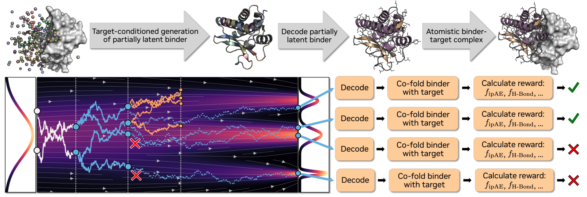

# Search, Refinement & Reward Models

Comprehensive guide to using search strategies, refinement protocols, reward models, and parameter sweeps to optimize generated protein designs.

<p align="center">
  
</p>

**Back to [README](../README.md)**

---

## Table of Contents

- [Overview](#overview)
- [Search Strategies](#search-strategies)
  - [Vanilla (Default)](#vanilla-default)
  - [Best-of-N](#best-of-n)
  - [Beam Search](#beam-search)
- [Refinement Strategies](#refinement-strategies)
  - [BindCraft (Sequence Optimization)](#bindcraft-sequence-optimization)
  - [Gradient Ascent (Latent Optimization)](#gradient-ascent-latent-optimization)
  - [Integrated Refinement](#integrated-refinement-with-generation)
- [Reward Models](#reward-models)
  - [Available Reward Configs](#available-reward-configs)
  - [Available Metrics (Full Catalog)](#available-metrics-full-catalog)
  - [Creating Custom Rewards](#creating-custom-rewards)
  - [Python API](#python-api)
- [Inference Sweeps](#inference-sweeps)
  - [Sweep Config Format](#sweep-config-format)
  - [Using sweep.py](#using-sweeppy)
  - [Using launch_sweep.sh](#using-launch_sweepsh)
  - [Example Sweep Configs](#example-sweep-configs)
- [Launch Scripts Reference](#launch-scripts-reference)

---

## Overview

The model supports three layers of optimization, each increasing in compute cost and quality:

| Layer | What It Does | Cost | When to Use |
|-------|-------------|------|-------------|
| **Vanilla** | Single-pass generation (default) | 1× | Quick exploration, simple tasks |
| **Search** | Multi-sample generation with reward-guided selection | 10–100× | Hard tasks (binder design, motif scaffolding) |
| **Refinement** | Post-generation optimization of sequence or latents | 50–500× | Final optimization of best candidates |

These compose naturally: **Vanilla → Search → Refinement** for maximum quality. In practice, start with vanilla and escalate only if needed.

---

## Search Strategies

### Vanilla (Default)

Standard generation without search. Each sample is independent.

```bash
python proteinfoundation/generate.py \
    inputs=design.json \
    ckpt_path=./checkpoints \
    ckpt_name=model.ckpt \
    nsamples=100
```

**When to use:** Initial exploration, unconditional generation, quick screening.

---

### Best-of-N

Generate N samples, evaluate all with a reward model, keep the top candidates.

```bash
python proteinfoundation/generate.py \
    inference_experiment=inference_test_search \
    inputs=design.json \
    ckpt_path=./checkpoints \
    ckpt_name=model.ckpt \
    nsamples=50 \
    search.strategy.n_samples=50
```

**Config** (`configs/inference_experiment/inference_test_search.yaml`):

```yaml
search:
  strategy:
    _target_: proteinfoundation.search.best_of_n.BestOfNStrategy
    n_samples: 50
    keep_all: false  # Only return the best sample per input

  rewards:
    metrics:
      rf3:
        _target_: proteinfoundation.metrics.rf3_metric.RF3Metric
        ckpt_path: /path/to/rf3_latest.pt
        num_steps: 50
    weights:
      rf3.plddt: 1.0
      rf3.iptm: 2.0
    differentiable: false
```

| Parameter | Default | Description |
|-----------|---------|-------------|
| `n_samples` | 10 | Number of samples to generate and evaluate per input |
| `keep_all` | `false` | If `true`, keep all N samples; if `false`, return only the best |

**When to use:** Moderate-difficulty tasks where generating more samples is sufficient. Simpler and more parallelizable than beam search.

---

### Beam Search

Maintain a beam of top-N trajectories, branching and pruning at intermediate diffusion steps. Most effective for hard conditioning problems where trajectory-level decisions matter.

```bash
python proteinfoundation/generate.py \
    inference_experiment=inference_test_beam \
    inputs=design.json \
    ckpt_path=./checkpoints \
    ckpt_name=model.ckpt \
    search.strategy.beam_width=4 \
    search.strategy.n_branch=4
```

**Config** (`configs/inference_experiment/inference_test_beam.yaml`):

```yaml
search:
  strategy:
    _target_: proteinfoundation.search.beam_search.BeamSearchStrategy
    step_checkpoints: [0, 100, 200, 300, 400]  # Evaluate at these diffusion steps
    n_branch: 4      # Candidates per beam state
    beam_width: 4    # Top candidates to keep after pruning
    keep_intermediate_samples: true

  rewards:
    metrics:
      rf3:
        _target_: proteinfoundation.metrics.rf3_metric.RF3Metric
        ckpt_path: /path/to/rf3_latest.pt
        num_steps: 50
        n_recycles: 5
        metric_manager:
          _target_: foundry.metrics.metric.MetricManager
          metrics:
            backbone_rmsd:
              _target_: proteinfoundation.metrics.gt_structure_comparison.StructureComparisonMetric
              align_mask: is_protein
              subset_mask: is_protein_backbone
              metric_type: rmsd
            motif_rmsd:
              _target_: proteinfoundation.metrics.gt_structure_comparison.StructureComparisonMetric
              align_mask: is_protein & mapped_to_coordinate_conditioned_region
              subset_mask: is_protein & mapped_to_coordinate_conditioned_region
              metric_type: rmsd

    weights:
      rf3.backbone_rmsd...: -1.0    # Lower RMSD is better
      rf3.motif_rmsd...: -2.0       # Weight motif RMSD heavily
    differentiable: false
```

| Parameter | Default | Description |
|-----------|---------|-------------|
| `step_checkpoints` | `[0, 100, 200, 300, 400]` | Diffusion steps at which to evaluate and prune |
| `n_branch` | 4 | Candidates to generate at each branch point (L) |
| `beam_width` | 4 | Candidates to keep after each prune (N) |
| `keep_intermediate_samples` | `false` | Save intermediate structures for analysis |

**Algorithm:**

1. Initialize beam with N noise samples at t=0
2. For each checkpoint step:
   - Branch each beam state into L candidates
   - Roll out each to completion for reward evaluation
   - Keep top-N by reward score
3. Return all candidates that meet success criteria

**Compute cost:** Total samples evaluated = `N × L × (num_checkpoints - 1)`. With defaults: `4 × 4 × 4 = 64` evaluations.

**When to use:** Hard tasks where the diffusion trajectory matters (motif scaffolding, PPI binder design). More expensive but higher success rate than Best-of-N.

---

## Refinement Strategies

Refinement optimizes a **generated structure** after the diffusion process. It produces higher-quality designs at the cost of additional compute.

### BindCraft (Sequence Optimization)

Optimizes the binder **sequence** while keeping the backbone structure fixed. Uses AlphaFold2 gradients on sequence logits through three stages:

1. **Soft stage:** Optimize continuous sequence distribution with temperature annealing
2. **Hard stage:** Commit to discrete amino acid identities, polish with gradients
3. **Greedy stage:** Local single-position mutations, keep if reward improves

```bash
# Full protocol: soft → hard → greedy
python proteinfoundation/refine.py \
    --config-name refine_bindcraft \
    inputs=generated_binders/ \
    output_dir=refined/

# Fast mode: hard → greedy only (skip soft stage)
python proteinfoundation/refine.py \
    --config-name refine_bindcraft \
    inputs=generated_binders/ \
    refinement.strategy.mode=hard_only
```

| Parameter | Default | Description |
|-----------|---------|-------------|
| `mode` | `full` | `full` (3-stage) or `hard_only` (2-stage, faster) |
| `n_soft_iters` | 45 | Soft optimization iterations (temperature annealing) |
| `n_hard_iters` | 5 | Hard optimization iterations (discrete mutations) |
| `n_greedy_iters` | 15 | Greedy search iterations (local mutations) |
| `n_recycles` | 3 | AF2 recycles per evaluation |

**Requirements:** Differentiable reward model (AF2). Does **not** work with RF3 rewards.

**When to use:** PPI binder design where the backbone is good but the interface sequence needs optimization.

---

### Gradient Ascent (Latent Optimization)

Optimizes in **latent space** — co-optimizing both structure and sequence simultaneously. Requires the autoencoder checkpoint to encode/decode between structures and latents.

Uses adaptive line search: at each iteration, tries multiple step sizes and picks the one that maximizes reward.

```bash
python proteinfoundation/refine.py \
    --config-name refine_gradient_ascent \
    inputs=generated_structures/ \
    autoencoder_ckpt_path=/path/to/autoencoder.ckpt \
    refinement.strategy.n_iterations=50
```

| Parameter | Default | Description |
|-----------|---------|-------------|
| `n_iterations` | 50 | Optimization iterations |
| `line_search_steps` | `[1e-3, 1e-2, 1e-1, 1e0, 1e1, 1e2]` | Step sizes for adaptive line search |
| `update_bb_ca` | `false` | Whether to also optimize backbone CA positions |
| `normalize_logits` | `true` | Apply logit normalization during optimization |

**Requirements:** Differentiable reward model (AF2) + autoencoder checkpoint.

**When to use:** When both structure and sequence need refinement (motif scaffolding, unconditional generation). More powerful than BindCraft but requires AE.

---

### Integrated Refinement (with Generation)

Add refinement as a post-processing step to any generation run:

```bash
# Generation + BindCraft
python proteinfoundation/generate.py \
    inference_experiment=inference_test_search \
    inputs=design.json \
    ckpt_path=./checkpoints \
    ckpt_name=model.ckpt \
    refinement=bindcraft_full

# Generation + Gradient Ascent
python proteinfoundation/generate.py \
    inference_experiment=inference_test_search \
    inputs=design.json \
    ckpt_path=./checkpoints \
    ckpt_name=model.ckpt \
    refinement=gradient_ascent
```

---

## Reward Models

Reward models score generated structures and guide search strategies. They are fully modular — combine any metrics with custom weights.

The `RewardModel` class is a thin aggregator:

```
reward = Σ (weight_i × metric_i.output_key)
```

Positive weights → higher is better. Negative weights → lower is better.

### Available Reward Configs

| Config | Metrics | Differentiable | Speed | Use Case |
|--------|---------|---------------|-------|----------|
| `rf3.yaml` | RF3 pLDDT, ipTM, ipAE, min_ipAE | No | Slow (~30s/sample) | General PPI evaluation |
| `af2_binder.yaml` | AF2 pLDDT, pTM, PAE | **Yes** | Slow (~20s/sample) | Refinement-compatible PPI |
| `structure_quality.yaml` | SSE, RASA, Molprobity, H-bonds, sidechains | No | Fast (~1s/sample) | Quick screening |
| `multi_source.yaml` | AF2 + TMOL + RASA + Molprobity | No | Slow (~25s/sample) | Comprehensive evaluation |

### Available Metrics (Full Catalog)

**Refolding Metrics** — Refold the generated structure with an independent structure prediction model and compare. Slower but provides strong validation of designability.

| Metric Class | Config Key | Key Outputs | Differentiable | Description |
|-------------|------------|-------------|----------------|-------------|
| `RF3Metric` | `rf3` | `plddt`, `iptm`, `ipae`, `min_ipae`, `ptm` | **Yes** | RF3 refolding confidence (PyTorch diffusion model) |
| `AF2Metric` | `af2` | `plddt`, `ptm`, `pae`, `max_pae`, `iptm` | **Yes** | AlphaFold2 refolding confidence (JAX, via ColabDesign) |

**Force Field Metrics** — Evaluate physical plausibility using energy functions. These use either the **Rosetta scoring function** (via TMol, a GPU-accelerated PyTorch reimplementation of Rosetta) or **MACE**, a machine-learning force field trained on quantum-mechanical calculations.

| Metric Class | Config Key | Key Outputs | Backend | Description |
|-------------|------------|-------------|---------|-------------|
| `SoftDDGMetric` | `ddg` | `ddg`, `complex_energy`, `monomer_energy_sum` | TMol (Rosetta) | Binding ΔΔG with soft repulsion |
| `ChargeComplementarityMetric` | `charge` | `charge_score`, `n_salt_bridges` | NumPy | Salt bridge scoring across interface |
| `SoftDDGWithSaltMetric` | `ddg_salt` | `ddg_with_salt` | TMol (Rosetta) | Combined soft ΔΔG + charge complementarity |
| `TMOLMetric` | `tmol` | `total_interface_energy`, `n_interface_hbonds` | TMol (Rosetta) | Interface H-bond / electrostatic energy |
| `MACEEnergyMetric` | `mace` | `median_energy_diff` | MACE (ML force field) | Predicted vs ground-truth potential energy |

**Structure Quality Metrics** — Fast geometric and chemical validation of the generated structure, no refolding or energy computation required.

| Metric Class | Config Key | Key Outputs | Description |
|-------------|------------|-------------|-------------|
| `PoseBustersMetric` | `posebusters` | `pass_rate`, per-check results | Stereochemical validation of ligand molecules |
| `SSEMetrics` | `sse` | `helix_fraction`, `strand_fraction`, `coil_fraction` | Secondary structure composition |
| `RASAMetrics` | `rasa` | `mean_rasa`, `buried_fraction`, `core_fraction` | Relative solvent accessibility |
| `MolProbityMetrics` | `molprobity` | `clashscore`, `rama_favored`, `rotamer_outliers`, `cbeta_deviations` | MolProbity stereochemistry validation |
| `HbondMetrics` | `hbonds` | `num_hbonds`, `avg_energy`, `binder_hbonds` | Hydrogen bonds (via HBPlus) |
| `SidechainMetrics` | `sidechain` | `valid_sidechain_fraction`, `chain_breaks`, `n_clashes` | Sidechain packing quality |
| `HotspotMetrics` | `hotspot` | `hotspot_obedience`, `n_contacts` | Hotspot residue contact fraction |

**Comparison Metrics** — Compare generated vs. ground truth:

| Metric Class | Config Key | Key Outputs | Description |
|-------------|------------|-------------|-------------|
| `StructureComparisonMetric` | N/A | `rmsd`, `gdt_ts`, `tm_score` | Backbone/motif RMSD with flexible masking |
| `LDDTMetric` | `lddt` | `lddt`, `per_residue_lddt` | Local distance difference test |

### Creating Custom Rewards

Create a new reward in `configs/rewards/my_reward.yaml`:

```yaml
metrics:
  # Refolding metric: RF3 for PPI confidence
  rf3:
    _target_: proteinfoundation.metrics.rf3_metric.RF3Metric
    ckpt_path: /path/to/rf3_latest.pt
    num_steps: 50

  # Interface energy: TMol H-bonds
  tmol:
    _target_: proteinfoundation.metrics.tmol_metric.TMOLMetric
    enable_hbond: true
    enable_elec: false

  # Fast screening: MolProbity
  molprobity:
    _target_: proteinfoundation.metrics.molprobity_metrics.MolProbityMetrics

# Weights: positive = higher is better, negative = lower is better
weights:
  rf3.plddt: 1.0           # Higher pLDDT → better structure
  rf3.iptm: 3.0            # Higher ipTM → better interface (key for PPI)
  rf3.min_ipae: -2.0       # Lower min_ipAE → better interface
  tmol.n_interface_hbonds: 1.0  # More H-bonds → better interface
  molprobity.clashscore: -5.0   # Fewer clashes → better
  molprobity.rama_favored: 0.5  # More Ramachandran-favored → better

differentiable: false  # Set true only if ALL metrics are differentiable
```

Then use with any search strategy:

```bash
python proteinfoundation/generate.py \
    inference_experiment=inference_test_beam \
    inputs=design.json \
    ckpt_path=./checkpoints \
    ckpt_name=model.ckpt \
    reward=my_reward
```

### Python API

```python
from proteinfoundation.rewards import RewardModel
from proteinfoundation.metrics.rf3_metric import RF3Metric
from proteinfoundation.metrics.rasa_metrics import RASAMetrics
from proteinfoundation.metrics.tmol_metric import TMOLMetric

# Build reward model from individual metrics
reward_model = RewardModel(
    metrics={
        "rf3": RF3Metric(ckpt_path="/path/to/rf3.pt", num_steps=50),
        "rasa": RASAMetrics(),
        "tmol": TMOLMetric(enable_hbond=True),
    },
    weights={
        "rf3.iptm": 3.0,
        "rf3.min_ipae": -2.0,
        "rasa.mean_rasa": 1.0,
        "tmol.n_interface_hbonds": 1.0,
    },
)

# Compute scalar reward
reward = reward_model.compute_reward(predicted_atom_array=my_structure)

# Get detailed breakdown
components = reward_model.compute_components(predicted_atom_array=my_structure)
# → {"rf3.iptm": 0.85, "rf3.min_ipae": 4.2, "rasa.mean_rasa": 0.35, ...}

# Use with search
from proteinfoundation.search import BeamSearchStrategy

strategy = BeamSearchStrategy(
    step_checkpoints=[0, 100, 200, 300, 400],
    n_branch=4,
    beam_width=4,
)
results = strategy.generate(model, batch, reward_model)
```

---

## Inference Sweeps

When benchmarking or exploring design parameters, you often want to run the same inference pipeline across many parameter combinations (checkpoints, temperatures, diffusion steps, etc.).

The **sweep system** automates this: define sweep parameters in a YAML config, generate all combinations, and submit each as a SLURM job.

### Sweep Config Format

Create a file in `configs/sweeps/`:

```yaml
# Required
base_config: inference            # Hydra config name to compose on
sweep:                            # Parameters to sweep (Cartesian product)
  ckpt_name:                      # List of checkpoint names to compare
    - "model_epoch=00039_step=080000.ckpt"
    - "model_epoch=00079_step=160000.ckpt"
  generation.args.nsteps:         # Dot-notation for nested keys
    - 100
    - 400
  generation.args.temperature:
    - 0.5
    - 1.0

# Optional
base_config_overrides:            # Applied before sweep
  - inference_experiment=inference_like_rfd3
  - nsamples=100
output_dir: ./configs/sweep_configs/my_sweep
run_name_prefix: my_sweep
```

This generates **2 × 2 × 2 = 8 configs**, one for each combination.

### Using `sweep.py`

```bash
# Generate sweep configs from YAML
python script_utils/sweep.py --sweep-config configs/sweeps/ppi_benchmark.yaml

# Dry run: see what would be generated
python script_utils/sweep.py --sweep-config configs/sweeps/ppi_benchmark.yaml --dry-run

# Override output directory
python script_utils/sweep.py --sweep-config configs/sweeps/ppi_benchmark.yaml \
    --output-dir ./my_custom_dir

# Inline sweep (no YAML file needed):
python script_utils/sweep.py --base-config inference \
    --sweep 'generation.args.nsteps=[100,200,400]' \
    --sweep 'generation.args.temperature=[0.5,1.0]'
```

### Using `launch_sweep.sh`

End-to-end: generate configs and submit SLURM jobs for each:

```bash
# Generate + submit all sweep configs
./slurm_utils/launch_sweep.sh digs --sweep-config configs/sweeps/ppi_benchmark.yaml

# Dry run (generate configs only, don't submit)
./slurm_utils/launch_sweep.sh digs --sweep-config configs/sweeps/ppi_benchmark.yaml --dry-run

# With additional options
./slurm_utils/launch_sweep.sh ord \
    --sweep-config configs/sweeps/ppi_benchmark.yaml \
    --gpus-per-job 4 \
    --no-copy \
    ckpt_path=/path/to/checkpoints

# Offline validation sweep
./slurm_utils/launch_sweep.sh digs \
    --sweep-config configs/sweeps/offline_val_ckpt_sweep.yaml \
    --mode val \
    --ckpt-path /path/to/checkpoints \
    --njobs 8
```

### Example Sweep Configs

Pre-built sweep configs in `configs/sweeps/`:

| Config | What It Sweeps | Total Configs |
|--------|---------------|---------------|
| `ppi_benchmark.yaml` | 2 checkpoints × 3 nsteps × 2 temperatures | 12 |
| `enzyme_benchmark.yaml` | 2 checkpoints × 2 nsteps × 2 self_cond | 8 |
| `offline_val_ckpt_sweep.yaml` | 5 checkpoints | 5 |
| `search_strategy_sweep.yaml` | 3 strategies × 2 nsteps | 6 |

---

## Launch Scripts Reference

| Script | Purpose | Key Features |
|--------|---------|--------------|
| `launch_infer.sh` | Single inference run | Hydra config resolution, code copy, job arrays |
| `launch_offline_val.sh` | Offline validation on val sets | Checkpoint evaluation, auto-concatenation |
| `launch_sweep.sh` | Parameter sweep → multiple jobs | Generates configs from sweep YAML, submits each |
| `launch_search.sh` | Search-based generation | Beam search / Best-of-N on SLURM |

All scripts support: `--no-copy`, `--gpus-per-job`, `--follow`, and Hydra overrides as extra args.

```bash
# Check what a script expects
./slurm_utils/launch_infer.sh --help

# Common pattern
./slurm_utils/launch_infer.sh <cluster> [script-options] [hydra_key=value ...]
```
