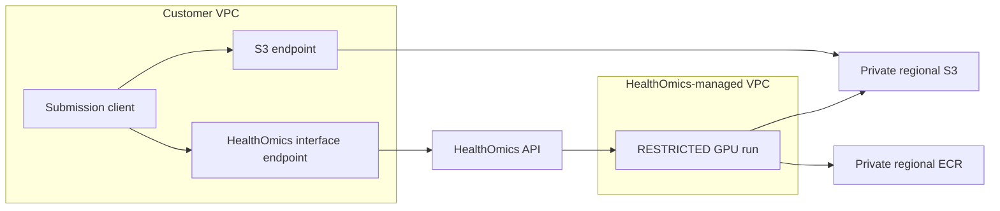

# Private networking for the HealthOmics example

HealthOmics removes the need to operate GPU servers or a workflow cluster. You
still configure access to your inputs, images and results. This example stages
the model and input in regional S3 and the image in private ECR, then explicitly
starts the run with `--networking-mode RESTRICTED`.

In this mode, workflow runs can access only same-Region S3 and ECR; they cannot
access the public internet. The model does not need a Hugging Face connection
during generation. AWS PrivateLink can additionally keep calls from a connected
client to the HealthOmics API off the public internet.

These are separate controls:

| Control | What it provides | Boundary |
| --- | --- | --- |
| `RESTRICTED` run networking | Same-Region S3/ECR access without public internet access | This is not a DNS allowlist; IAM and resource policies must still constrain data access |
| HealthOmics interface endpoint / PrivateLink | Private client-to-HealthOmics API traffic over the AWS network | The client must use the endpoint through its VPC or an appropriately connected private network |
| Optional `VPC` run networking | Access through ENIs in your subnets to private services, such as a license server | Routes, security groups and other network controls determine what the run can reach |
| Private S3/ECR and scoped run role | Controlled access to assets and results; encrypted storage and transport | Authorized users and workloads can still export data |

**HealthOmics compute runs in a HealthOmics-owned, managed VPC.** Connecting a run
to your VPC does not move that compute into your VPC. PrivateLink alone does not
guarantee that data never leaves your VPC/account, or prevent every form of
exfiltration. Use the narrower claim: **managed GPU execution with no public
internet access during restricted runs, and optional private API access**.

The [setup guide](README.md#outputs-and-validation) records the generation
validation separately. Private API calls, S3 permission boundaries and the
network behavior below were exercised in `us-east-1` using a dedicated VPC and
synthetic canaries. These tests do not certify a production data perimeter.

## Recommended starting point

Keep the setup guide's `RESTRICTED` run mode for this workflow. Pre-stage all
model files, inputs and dependencies; do not add runtime package installations
or model downloads. Use the dedicated bucket, prefix-scoped execution role and
private ECR repository from `bootstrap.yaml`.

If your submission client also requires private access, add a HealthOmics
interface endpoint to the client's VPC. This does not require changing the
workflow to `VPC` run mode.

For sensitive workloads that also need control over DNS queries, evaluate the
configured VPC path and [DNS controls](#control-dns-as-well-as-ip-traffic) below.
In the actual restricted-mode probe, the external DNS name still resolved even
though the tested external TCP connections failed.



S3 and ECR are regional services, not resources hosted inside your subnets.
The diagram distinguishes client API access from service-managed execution.

## Private client access with an interface endpoint

Use an existing approved VPC in the workflow Region. Enable VPC DNS support and
DNS hostnames, and private DNS on the endpoint. Its security group should permit
inbound TCP 443 from the submission client's security group or approved private
CIDR. Configure client egress and network ACLs accordingly; no public inbound
access is needed.

The HealthOmics workflow endpoint service is:

```text
com.amazonaws.us-east-1.workflows-omics
```

For another supported Region, replace `us-east-1`. Confirm service availability
and endpoint-policy support rather than hard-coding availability-zone names:

```bash
aws ec2 describe-vpc-endpoint-services --region "$AWS_REGION" \
    --service-names "com.amazonaws.$AWS_REGION.workflows-omics" \
    --query 'ServiceDetails[].{Service:ServiceName,Zones:AvailabilityZones,Policy:VpcEndpointPolicySupported}'
```

In the VPC console, create an **Interface** endpoint for that service, select
the approved VPC/subnets and endpoint security group, and enable private DNS.
Attach your organization's endpoint policy to constrain allowed principals and
operations. Endpoint policies add a permission boundary for traffic using that
endpoint; they do not grant permissions missing from the caller's IAM policies.

A workstation outside the VPC does not automatically use PrivateLink. Run the
submission client inside the VPC, or connect through an approved VPN/Direct
Connect path with private DNS resolution, such as Route 53 Resolver forwarding.

Plan other endpoints according to what the client actually does:

| Client operation | Private access to configure |
| --- | --- |
| Create/read workflows; submit, monitor or cancel runs | `com.amazonaws.REGION.workflows-omics` interface endpoint |
| Tagging API calls | `com.amazonaws.REGION.tags-omics` interface endpoint, when needed |
| Upload/download S3 assets from clients in the VPC | S3 gateway endpoint associated with the client subnet route tables |
| Direct S3 access from on-premises | S3 interface endpoint and suitable DNS/routing; a gateway endpoint is not reachable directly over VPN/Direct Connect |
| ECR login, image metadata, push/pull | `ecr.api` and `ecr.dkr` interface endpoints with private DNS, plus S3 access for image layers |
| Read CloudWatch logs | `logs` interface endpoint |
| Assume roles or call regional STS from the client | Regional `sts` interface endpoint, when needed |

Finch runs in a VM on macOS. Verify that its DNS and route to ECR use the intended
private path, not only that the host's AWS CLI can reach the API. Building the
image and downloading the bundle also need access to their upstream registries.
Use an approved connected build environment or mirror those dependencies before
using a client without internet access.

An existing ECR endpoint with private DNS can also affect a builder in a public
subnet. Verify which endpoint its API and registry names resolve to. The endpoint
security group and policy must permit that builder's push operations, in addition
to its IAM permissions. Keep the workflow run role limited to pull operations.
Coordinate changes to shared endpoints with their owner; do not broaden a shared
security group simply to make a build pass.

If an S3 endpoint policy restricts buckets, account for ECR layer downloads:
they need `s3:GetObject` on
`arn:aws:s3:::prod-REGION-starport-layer-bucket/*`, in addition to the application's
own authorized S3 paths. Do not grant writes to the ECR layer bucket.

Do not add an unconditional bucket-policy deny based on the client's
`aws:SourceVpce` to the example bucket. HealthOmics-managed staging and publication
may not traverse that client endpoint. Such a policy can break runs even when
client uploads work. Design any data-perimeter policy with the actual service
access paths and required exceptions, then test it before handling sensitive data.

## Optional: connect a run to private VPC resources

Use `VPC` run mode only when the task needs connectivity beyond restricted
S3/ECR access. Merely selecting `VPC` does not make a run more isolated.

Choose private subnets in HealthOmics-supported Availability Zones in the same
Region, at most one subnet per zone. The subnet and security-group IDs must
belong to the same VPC. Check free subnet IPs and ENI quotas. Select multiple
supported zones when possible; consult the current AWS requirements for the
Region rather than copying example zone names.

For execution without internet access, review both IPv4 and IPv6 routes and
any NAT, internet gateway, transit, VPN or proxy path. Restrict egress to the
required endpoints/private services. Provide regional S3/ECR endpoints and
their policies as required by the documented VPC access path. Adding a NAT
gateway would enable internet access when security groups and routes allow it.

After the network owner has prepared those resources, use the same shell
variables as the setup guide and replace the example IDs below:

```bash
export RFD4_VPC_CONFIGURATION="rfd4-private-$RFD4_TAG"
cat > "$RFD4_WORK_DIR/vpc-run-configuration.json" <<'JSON'
{
  "vpcConfig": {
    "securityGroupIds": ["sg-REPLACE_WITH_RUN_SECURITY_GROUP"],
    "subnetIds": ["subnet-REPLACE_WITH_PRIVATE_SUBNET"]
  }
}
JSON
aws omics create-configuration --region "$AWS_REGION" \
    --name "$RFD4_VPC_CONFIGURATION" \
    --description "Private resource access for RFD4 generation" \
    --run-configurations "file://$RFD4_WORK_DIR/vpc-run-configuration.json"
aws omics get-configuration --region "$AWS_REGION" \
    --name "$RFD4_VPC_CONFIGURATION"
```

The initial configuration creates the `AWSServiceRoleForHealthOmics`
service-linked role when needed; the caller needs the corresponding
`iam:CreateServiceLinkedRole` permission. This is separate from the workflow
execution role. HealthOmics manages the ENIs; do not modify or delete them
manually.

Wait for configuration status `ACTIVE` before starting a run. Configuration
creation can take up to 15 minutes. Configurations are immutable; create a new
configuration to change the network settings.

For the run submission command in setup step 7, replace
`--networking-mode RESTRICTED` with these two arguments, keeping the other
parameters:

```bash
--networking-mode VPC \
--configuration-name "$RFD4_VPC_CONFIGURATION"
```

Use a fresh run name and output prefix for the connectivity test. Do not treat
the previous restricted-mode results as validation of this new network path.

## Control DNS as well as IP traffic

PrivateLink, a missing NAT route and security-group egress rules do not together
constitute a DNS allowlist. Traffic to Amazon-provided DNS needs separate
consideration; security groups and network ACLs do not filter that resolver
traffic. Use Route 53 Resolver DNS Firewall when your policy requires limiting
which names the workload may resolve.

Have the network owner configure and verify:

1. An allowlist for the required endpoint and private-service names.
2. Allow rules evaluated before a catch-all block rule, with all associated
   rule-group priorities reviewed. The validation used `NXDOMAIN` responses.
3. The VPC association and the intended fail-open/fail-closed setting. The
   validation VPC used `FirewallFailOpen=DISABLED`.
4. Resolver query logging with encryption and restricted readers. DNS names can
   themselves contain sensitive information.
5. Successful required operations, blocked unapproved DNS queries, and blocked
   connections to unapproved IPs without using DNS.

The isolated test allowed `*.amazonaws.com` and `*.internal`, then blocked other
names. Review and narrow the allowed names for your actual dependencies; this
test list is not a universal production policy. Keep endpoint and IAM policies
scoped as well. A permitted AWS hostname does not grant permission to use an
arbitrary bucket, repository or API.

The same CPU probe image was run in both networking modes:

| Test inside the actual workflow container | `RESTRICTED` | Configured `VPC` mode |
| --- | --- | --- |
| Fetch the synthetic private-service canary | Could not reach it | Succeeded |
| TCP 443 to two tested destinations outside the allowlist | Blocked | Blocked |
| Resolve the tested external DNS name | Resolved | Blocked |
| Resolve the HealthOmics API name | Public service address | Private endpoint addresses |

Client-side tests also confirmed allowed S3 reads/writes, denied access outside
approved prefixes and to another bucket, and a HealthOmics API denial explicitly
caused by the endpoint policy. No proprietary research data was used.

## Validate the network boundary

Before using private or sensitive inputs:

1. From the actual submission client, confirm that the regional
   `workflows-omics` hostname resolves to the interface endpoint's private
   addresses. Check endpoint state, private DNS, security groups and route tables.
2. Test the intended operations with that client's role: submit/read a run,
   access only the approved S3 paths, and pull the selected image. Also check
   that a role or path outside the approved policy scope is denied.
3. Inspect `get-run` for the requested `networkingMode` and, for VPC runs,
   `configuration` details. Test access to the intended private dependency from
   a small diagnostic task. For a no-internet VPC design, separately test that
   access to a public destination you control fails. Test unapproved DNS names
   separately from direct IP connections.
4. Use CloudTrail and VPC Flow Logs where supported to corroborate the route
   and access decisions. Avoid logging credentials or sensitive input content.
5. Re-run the short generation example and validate its published inventory,
   seeds and hashes. Retain denied-access tests and configuration details as
   evidence; a successful generation alone does not prove egress restrictions.

Endpoint ENIs and private connectivity may incur charges even when no GPU run
is active. Keep them under the network owner's lifecycle and access controls.

## AWS references

- [HealthOmics VPC networking and requirements](https://docs.aws.amazon.com/omics/latest/dev/workflows-vpc-networking.html)
- [HealthOmics internet access and network paths](https://docs.aws.amazon.com/omics/latest/dev/workflows-vpc-internet.html)
- [HealthOmics interface endpoints and service names](https://docs.aws.amazon.com/omics/latest/dev/vpc-interface-endpoints.html)
- [Amazon ECR VPC endpoints and S3 layer access](https://docs.aws.amazon.com/AmazonECR/latest/userguide/vpc-endpoints.html)
- [Amazon S3 gateway endpoint limitations](https://docs.aws.amazon.com/vpc/latest/privatelink/vpc-endpoints-s3.html)
- [Route 53 Resolver DNS Firewall](https://docs.aws.amazon.com/Route53/latest/DeveloperGuide/resolver-dns-firewall.html)
- [Managing DNS Firewall domain lists](https://docs.aws.amazon.com/Route53/latest/DeveloperGuide/resolver-dns-firewall-user-managed-domain-lists.html)
